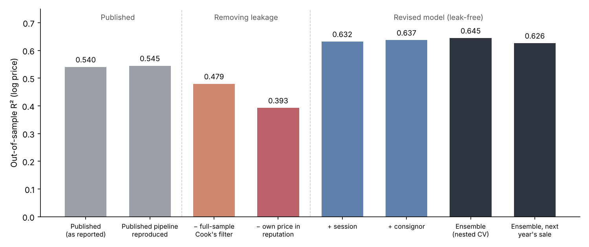

# Revised machine-learning analysis

Revision of the ML part of Yang, Clarke, Mandal, Nguyen & Pham (2026), *"Predicting Thoroughbred Yearling
Auction Prices with Machine Learning: Evidence from the Keeneland September Sale,"* JAAE,
doi:10.1017/aae.2026.10050. Writing and citation issues are out of scope here.

Everything runs from `sold.csv` (6,416 sold yearlings, 2020–2024):

```bash
pip install -r revision/requirements.txt
cd revision
python 01_leakage_audit.py         # reproduce the published Ridge and remove each leak in turn  (~4 min)
python 02_nested_cv.py             # nested-CV comparison of feature sets and models            (~30 min, cached in results/oof/)
python 03_temporal.py              # train on earlier years, predict a later sale; conformal intervals (~6 min)
python 04_inference_and_sessions.py  # OLS with clustered SEs, session heterogeneity, permutation importance
python 05_summary.py               # paired fold comparisons + figure
```

All output tables are in `results/` (Markdown and CSV).



## 1. Bottom line

| | Out-of-sample R² (log price) |
|---|---|
| Published Ridge (as reported) | 0.540 |
| Published pipeline, reproduced here | 0.545 (α ≈ 1.42 vs 1.451 published) |
| Same model, leaks removed | **0.39** |
| Revised Ridge (adds session + consignor), nested CV | **0.637** (SE 0.009) |
| Revised ensemble (Ridge + LightGBM + CatBoost), nested CV | **0.645** (SE 0.009) |
| Revised ensemble, predicting a later sale year (2022–2024 avg) | **0.626** |
| Revised Ridge, predicting a later sale year | **0.622** |

The published 0.54 was inflated by leakage. With the leaks removed, the published predictors explain only about
39–43% of the variation. Adding the **sale session** fixes that and more: the revised model scores about 0.64 under
honest evaluation, and holds up when trained on earlier years and used to predict a later sale.

## 2. Problems in the published ML pipeline and how each was fixed

| # | Problem in the paper | Evidence | Fix in this revision |
|---|---|---|---|
| 1 | **Target leakage in reputation indices.** Sire and Dam Reputation are computed from offspring log prices on the full sample. Each horse's own price, including test-set horses, enters its own predictors. | 27% of horses have a dam with exactly two yearlings in the sample, so their Dam Reputation is built from two prices, one being their own. Correlation with own price is 0.79. Removing this leak alone drops test R² from 0.479 to 0.393 (`results/01_leakage_audit.md`). | Reputation is **cross-fitted**: training rows get scores from the other folds, and predicted rows get scores from the training data only (`common.CrossFitReputation`). In the year-ahead test, scores come from earlier sales only. |
| 2 | **Outlier removal on the full sample using the outcome.** Rows are dropped by Cook's distance before the train/test split, so hard-to-predict horses are removed from the test set. | Reproducing the D > 4/n rule removes 315 rows; scoring on all rows drops R² from 0.545 to 0.479. | No price-based exclusions. Every one of the 6,416 horses is scored. Robustness is checked with Huber loss instead (R² 0.634, no gain). |
| 3 | **Feature screening and power transforms fitted on the full sample.** | Paper Sections 3.1–3.2. | Fixed outcome-free transforms (log1p). Feature sets are fixed in advance and compared by nested CV. All imputation, scaling, encoding and tuning happen inside the training folds (`sklearn` Pipelines). |
| 4 | **Sale session left out as a predictor**, even though Figure 1 shows it's the main source of price differences. Session is printed in the catalog before bidding, so using it is legitimate. | Adding session raises leak-free R² by 0.203, and every fold improves (`results/05_paired_comparisons.md`). Permutation importance: session ≈ 0.75 R², the next group ≈ 0.03. | Session enters as fixed effects (linear models) or as an ordinal variable (trees). The consigning agency's reputation is also added (cross-fitted). It adds +0.005 R², improving all 5 folds. |
| 5 | **First-crop flag is mismeasured.** "First crop" = first year the sire appears in the 2020–2024 data, so **100% of 2020 horses are flagged**, versus 16–29% in other years. The published coefficient (0.373) is mixed up with the 2020 baseline and the year effects. | `common.load_data` | Replaced by "sire new to the sale" (no yearlings in any *earlier* sample year), defined from 2021 on. A true first-crop flag needs the sire's first-crop year from Equineline. |
| 6 | **Ridge chosen for "inference", with bootstrap p-values on penalized coefficients.** At α ≈ 1.45 and n ≈ 3,500 the Ridge is essentially OLS, and bootstrap CIs around a penalized estimator aren't valid. | Ridge and OLS give identical R² (0.6366 vs 0.6366). | Prediction and interpretation are separated. Interpretation uses **OLS with standard errors clustered by sire** (yearlings by the same sire share unobserved factors) on cross-fitted reputation scores (`results/04_inference_and_sessions.md`). |
| 7 | **Session-level Ridge fits are not comparable.** Each session gets its own α (0.72 to 42.9), so coefficients are shrunk by different amounts. Within-session R² is also compared across sessions with very different price variance. | Paper Table 6. | One pooled model, with **Sire Rep × Book interactions and a cluster-robust Wald test**. Session accuracy is reported as RMSE (comparable across sessions) with bootstrap CIs, from one pooled model's out-of-fold predictions. |
| 8 | **Leave-one-year-out with year fixed effects is ill-defined.** The held-out year's effect can't be estimated. Also, training on future years to predict the past isn't a forecast. | Paper Section 4.4. | **Rolling-origin evaluation**: train on years before t, predict year t (2022, 2023, 2024). Test rows get the latest year's market level, and the unforecastable shift is reported separately. |
| 9 | **Inconsistent evaluation description** ("60/20/20 split" vs "15-fold CV"; CV SE 0.0075 in Table 2 vs ±0.0279 in Table 3). | Paper Tables 2–3. | One clearly defined protocol: 5-fold outer CV stratified by session, with 4–5-fold inner CV for tuning. Every horse is predicted exactly once by a model that never saw its price. |
| 10 | **No uncertainty for individual predictions**, although the paper pitches "pricing benchmarks". | — | **Split-conformal prediction intervals**, calibrated on earlier years and checked on the next year: 90% intervals cover 88–93% (`results/03_temporal.md`). |

## 3. Main results of the revised analysis

### 3.1 Model comparison (nested CV, N = 6,416) — `results/02_nested_cv.md`

| Model | Features | R² | SE | RMSE | MAE | Median abs. % error ($) |
|---|---|---|---|---|---|---|
| Ridge | F0: published predictors (leak-free) | 0.429 | 0.010 | 1.072 | 0.851 | 59.6% |
| LightGBM | F0 | 0.452 | 0.009 | 1.050 | 0.824 | 58.8% |
| Ridge | F1: + session | 0.632 | 0.009 | 0.860 | 0.665 | 48.5% |
| Ridge | F2: + consignor reputation | 0.637 | 0.009 | 0.854 | 0.661 | 48.4% |
| Ridge | F3: + extra pedigree, color, counts | 0.637 | 0.009 | 0.855 | 0.662 | 48.5% |
| Random forest | F3 | 0.635 | 0.009 | 0.856 | 0.664 | 48.9% |
| XGBoost | F3 | 0.640 | 0.009 | 0.850 | 0.658 | 47.9% |
| LightGBM | F3 | 0.641 | 0.009 | 0.849 | 0.657 | 48.0% |
| CatBoost (native target stats) | F3 | 0.643 | 0.010 | 0.847 | 0.656 | 48.1% |
| **Average ensemble** | F3 | **0.645** | 0.009 | 0.845 | 0.654 | 47.7% |

Fold-paired comparisons (`results/05_paired_comparisons.md`):
- Session is by far the biggest gain (+0.203).
- Consignor reputation adds +0.005, improving all 5 folds.
- The extra pedigree statistics add nothing.
- Nonlinear models add only +0.004 to +0.007 over the revised Ridge. The ensemble wins in all 5 folds (t = 4.3), but the gain is economically small.

### 3.2 Predicting a later sale — `results/03_temporal.md`

| Model | 2022 | 2023 | 2024 | Mean |
|---|---|---|---|---|
| Ridge, published predictors | 0.394 | 0.365 | 0.268 | 0.342 |
| Ridge, F2 | 0.636 | 0.608 | 0.621 | 0.622 |
| LightGBM, F3 | 0.615 | 0.603 | 0.625 | 0.615 |
| CatBoost, F3 | 0.632 | 0.603 | 0.632 | 0.622 |
| Average ensemble | 0.637 | 0.611 | 0.631 | 0.626 |

The year-level market shift accounts for less than 0.01 of R². Per-year prediction intervals, multiplicative on
price, are about ×/÷2.8 at 80% and ×/÷4.0 at 90%.

### 3.3 Interpretation — `results/04_inference_and_sessions.md`

- **Sire reputation mostly works through session placement.** In OLS with clustered SEs, a 1-SD increase in
  cross-fitted Sire Reputation goes with +0.66 log points without session effects, but only +0.16 with them. Better
  sires get placed in earlier sessions; within a session, sire reputation still matters, but much less.
- **Dam Reputation is weak once leakage is removed** (0.034 → 0.014, not significant with session FE).
  Permutation importance ≈ 0. The paper's measurement-error story isn't needed: most dams have no prior sales in the
  sample to build a reputation from.
- Consignor reputation (+0.09 per SD), sire black-type rate (+0.12), males (+0.11 log points ≈ 12%), and
  sire-new-to-sale (+0.20) remain significant with session FE.
- **The sire-reputation slope falls across books**: 0.26 (Sessions 1–2), then 0.22, 0.19, 0.13, 0.09, down to −0.01
  (Sessions 11–12). The Wald test that the slopes are equal gives p = 0.0002. Caveat: sessions are assigned partly on
  expected price, so slopes within a session are affected by that selection.
- **Accuracy by session**: RMSE rises from about 0.61 (Session 1) to 0.89–0.97 (Sessions 6–9). Median absolute
  dollar error rises from 39% to 52%. Within-session R² is 0.08–0.21. The paper's 0.21–0.37 was inflated by the
  same leakage.

## 4. What this means for the paper's ML sections

1. **Headline number:** report about 0.64 (nested CV) and about 0.63 (predicting the next sale), not 0.54. Also
   state that the published predictors alone reach only about 0.43 without leakage.
2. **Main message changes:** the sale session is the dominant pre-sale signal, and pedigree and reputation
   signals add value *within* sessions. Keeneland places yearlings after inspecting them, so session partly reflects
   an expert judgement of conformation that the catalog statistics don't contain. Say this openly. It explains why
   pedigree-only models stop near 0.43.
3. **Model choice:** keep Ridge or OLS as the readable benchmark (0.637). Report the ensemble as the best predictor
   (0.645), and say plainly that ML adds little once session is included.
4. **Reputation indices must be cross-fitted or built from earlier years only**, and the methods section should
   say so explicitly.

## 5. Remaining limitations (cannot be fixed with `sold.csv`)

- **Look-ahead in pedigree statistics.** Progeny counts and earnings (Sire_starters, AEI, etc.) look like they were
  pulled after the sales, not as of each catalog date: only 2.6% of rows have a sire with zero starters. That leaks
  some future racing information. A clean fix needs Equineline snapshots dated to each sale.
- **Unsold horses aren't in the data** (no RNAs or buybacks), so the model describes sold horses only. Adding RNA
  and buyback records would allow a selection model.
- **Prices in `sold.csv` are not round hammer prices** (for example 155,503.608), so they look inflation-adjusted.
  Check this before quoting dollar figures. Log-scale results with year effects are unaffected.
- No hip-level variables (foaling date, dam produce record, X-rays or conformation). These are the most likely
  sources of further gains.
